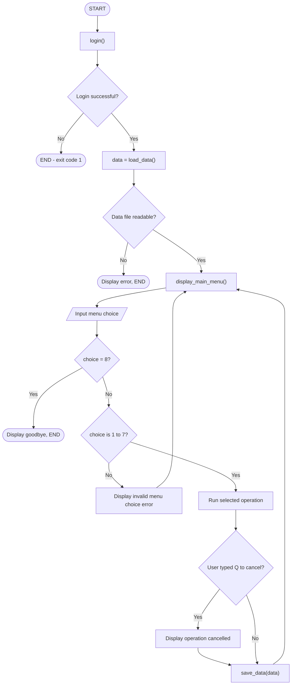
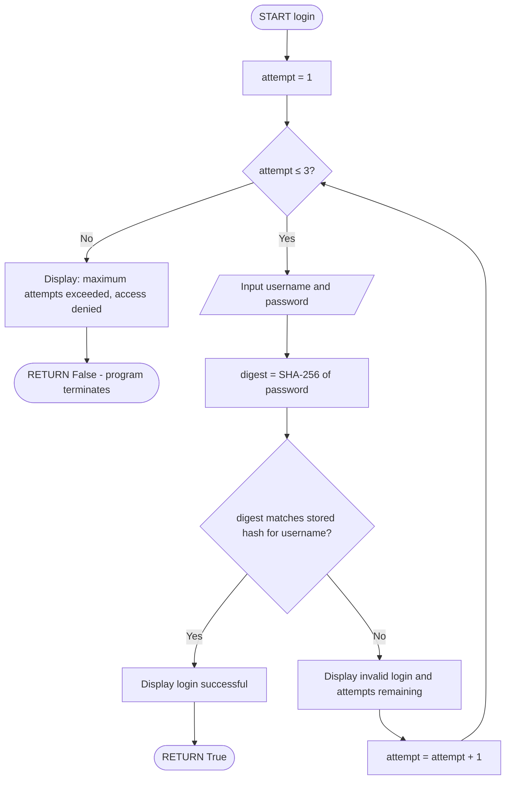
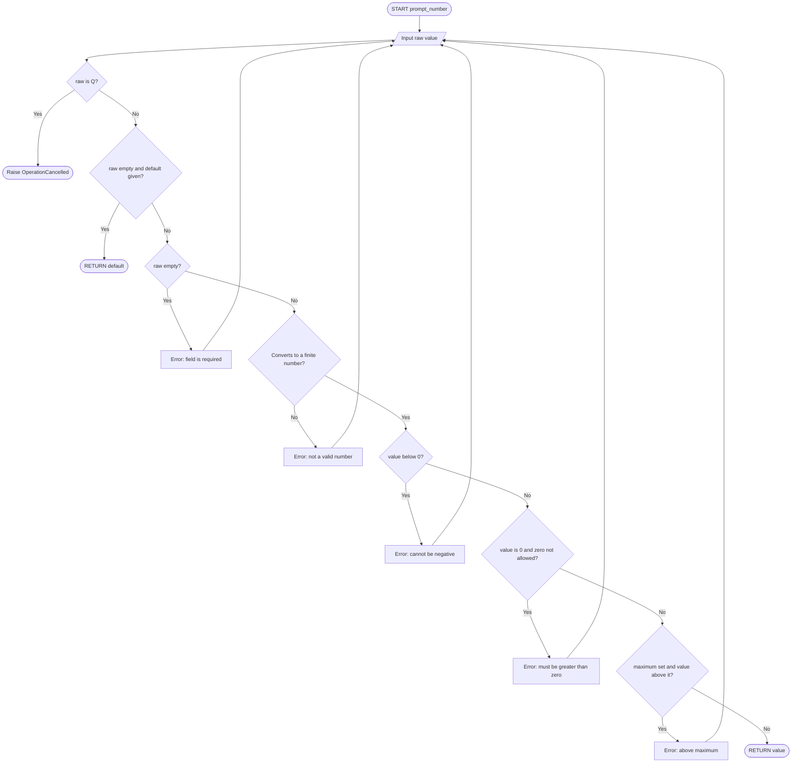
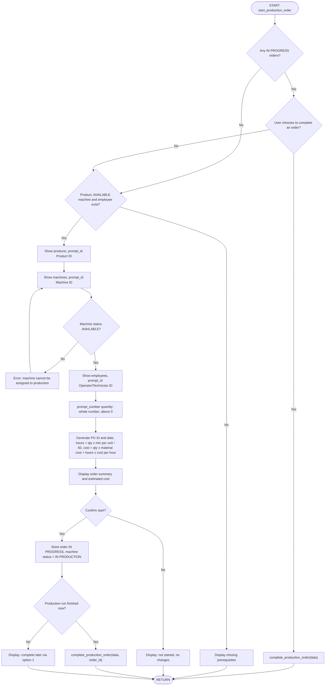
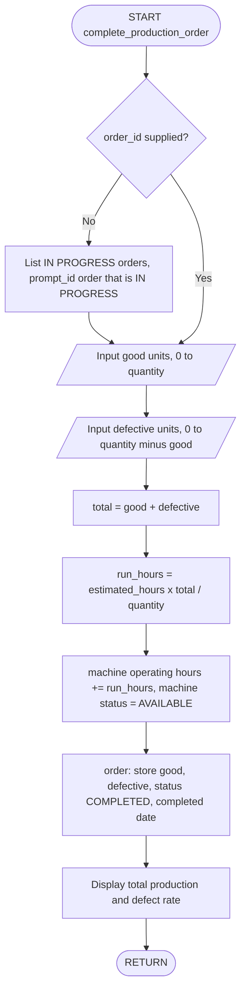
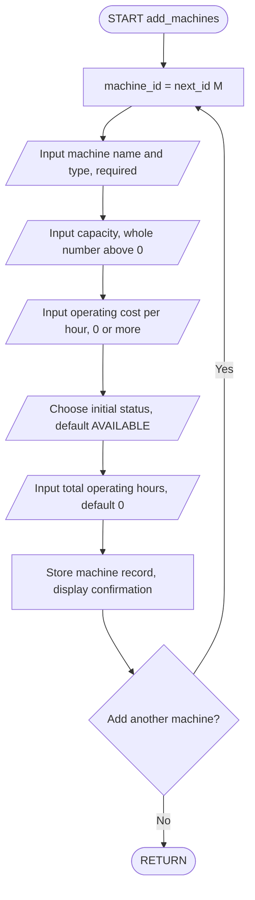
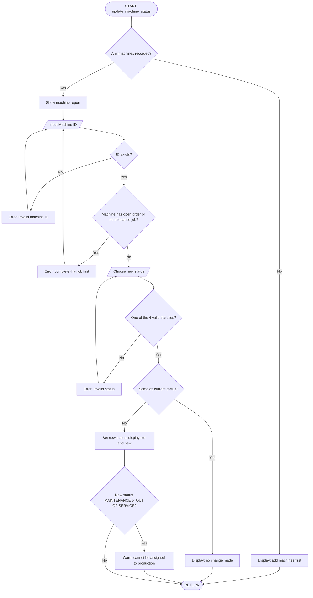
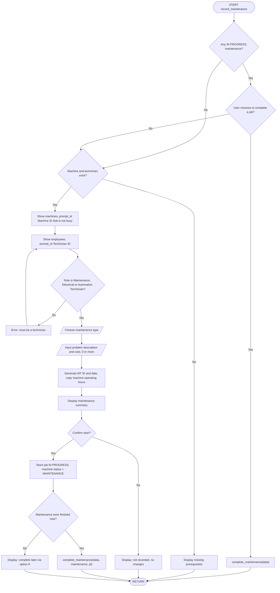
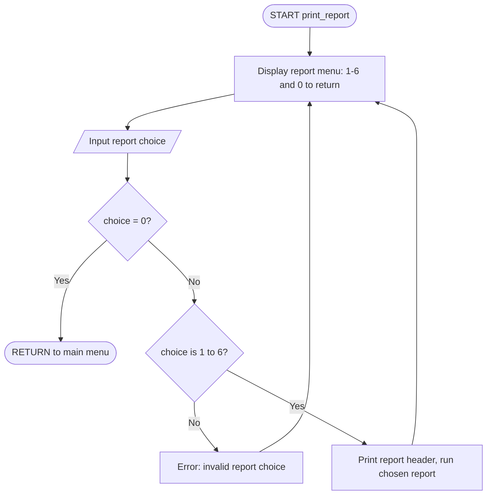
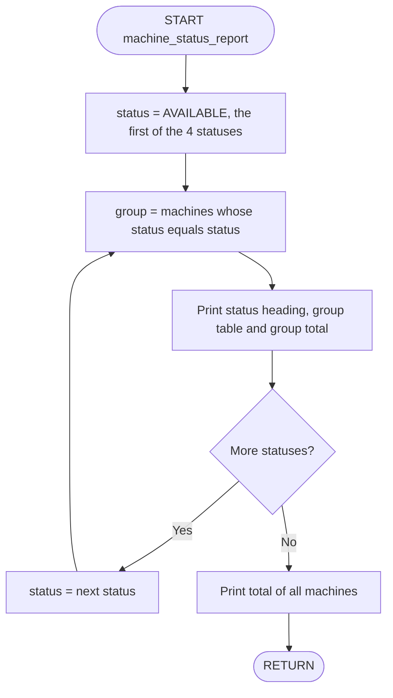

# Factory Automation Management System — Design Documentation

SmartTech Manufacturing Ltd. · program file: `factory_system.py`

---

## 1. Hierarchy Chart

### 1a. Top-level structure chart

```
                                  ┌────────────┐
                                  │    main    │
                                  └─────┬──────┘
        ┌─────────────┬─────────────────┼──────────────────┬───────────────┐
  ┌─────┴─────┐ ┌─────┴─────┐ ┌─────────┴─────────┐ ┌──────┴───────┐ ┌─────┴─────┐
  │   login   │ │ load_data │ │ display_main_menu │ │ menu options │ │ save_data │
  └───────────┘ └───────────┘ └───────────────────┘ └──────┬───────┘ └───────────┘
                                                           │
                                              (expanded in 1b, options 1-8)
```

### 1b. Full call hierarchy

```
main
├── login
│   └── print_header
├── load_data
│   └── next_id                                  (seeds the 4 standard products)
├── display_main_menu
│   └── print_header
├── 1. start_production_order
│   ├── print_header
│   ├── prompt_choice ──────────► ask
│   ├── product_report ─────────► print_table, money
│   ├── machine_report ─────────► print_table, money
│   ├── employee_report ────────► print_table, full_name
│   ├── prompt_id ──────────────► ask
│   ├── prompt_number ──────────► ask
│   ├── prompt_yes_no ──────────► ask
│   ├── next_id, full_name, money, print_details
│   └── complete_production_order
│       ├── print_table
│       ├── prompt_id ──────────► ask
│       ├── prompt_number ──────► ask
│       ├── defect_rate
│       └── print_details
├── 2. add_machines
│   ├── print_header, next_id
│   ├── prompt_text ────────────► ask
│   ├── prompt_number ──────────► ask
│   ├── prompt_choice ──────────► ask
│   └── prompt_yes_no ──────────► ask
├── 3. add_update_product
│   ├── print_header, next_id
│   ├── product_report ─────────► print_table, money
│   ├── prompt_choice ──────────► ask
│   ├── prompt_id ──────────────► ask
│   └── product_form
│       ├── prompt_text ────────► ask
│       └── prompt_number ──────► ask
├── 4. add_employee
│   ├── print_header, next_id, full_name
│   ├── prompt_text ────────────► ask
│   └── prompt_choice ──────────► ask
├── 5. update_machine_status
│   ├── print_header
│   ├── machine_report ─────────► print_table, money
│   ├── prompt_id ──────────────► ask
│   │   └── machine_busy_reason  (eligibility check)
│   └── prompt_choice ──────────► ask
├── 6. record_maintenance
│   ├── print_header
│   ├── machine_report, employee_report ─► print_table
│   ├── prompt_choice, prompt_id, prompt_text, prompt_number, prompt_yes_no ─► ask
│   │   └── machine_busy_reason  (eligibility check)
│   ├── next_id, full_name, money, print_details
│   └── complete_maintenance
│       ├── print_table
│       ├── prompt_id ──────────► ask
│       └── prompt_yes_no ──────► ask
├── 7. print_report
│   ├── print_header
│   ├── machine_report ─────────► print_table, money
│   ├── production_report ──────► print_table, defect_rate, money, print_details
│   ├── product_report ─────────► print_table, money
│   ├── machine_status_report ──► print_table
│   ├── maintenance_report ─────► print_table, money
│   └── employee_report ────────► print_table, full_name
├── 8. Exit
└── save_data                                    (after every operation)
```

---

## 2. IPO Charts (every function)

| # | Function | Input | Processing | Output |
|---|----------|-------|------------|--------|
| 1 | `main()` | Menu choice; data file | Call `login` (exit if it fails); `load_data` (exit if unreadable); loop: show menu, validate choice, dispatch through `MAIN_MENU`, catch Q-cancel, `save_data` after every operation; stop on 8 | Menus and messages; saved data file; exit code |
| 2 | `login()` | Username and password (max 3 attempts); `AUTHORIZED_USERS` | Hash password (SHA-256); constant-time compare with stored hash; count attempts | `True`/`False`; success, "attempts remaining" or lock-out message |
| 3 | `display_main_menu()` | `MAIN_MENU` dictionary | Print header, then each option number and label | Main menu on screen |
| 4 | `load_data(path)` | Data file path | If no file: build empty tables and seed 4 products with generated IDs. Else read JSON and confirm all 5 tables exist | Data dictionary (or `OSError`/`ValueError`) |
| 5 | `save_data(data, path)` | Data dictionary; path | Write JSON to a temp file, then atomically replace the data file | Updated `factory_data.json` |
| 6 | `ask(message)` | Prompt text; one keyboard line | Trim spaces; if "Q", raise `OperationCancelled` | Trimmed string |
| 7 | `prompt_text(...)` | Message, default, pattern, hint, max length | Repeat until value is non-empty, within max length and matches pattern; Enter returns default | Valid string |
| 8 | `prompt_number(...)` | Message, cast (int/float), allow_zero, maximum, default | Repeat: convert; reject empty, non-numeric, NaN/∞, negative, zero (if not allowed), above maximum | Valid number |
| 9 | `prompt_choice(...)` | Message; tuple of options; default | List numbered options; accept an in-range number or option text (any case) | Selected option |
| 10 | `prompt_yes_no(message)` | Message | Repeat until Y/YES/N/NO | `True`/`False` |
| 11 | `prompt_id(...)` | Message; table; label; optional `check` function | Upper-case the ID; reject empty, unknown, or ineligible (check returns a reason) | Valid record ID |
| 12 | `next_id(prefix, table, width)` | Prefix; table; width | Record count + 1, zero-padded | ID string, e.g. `M001`, `PO0001` |
| 13 | `money(amount)` | Amount | Format with `$`, thousands separators, 2 decimals | Currency string |
| 14 | `full_name(employee)` | Employee record | Join first and last names | Name string |
| 15 | `defect_rate(good, defective)` | Good units; defective units | Total = good + defective; rate = defective ÷ total × 100 (0 if total is 0) | Percentage |
| 16 | `print_header(title)` | Title | Center title between two rule lines | Banner |
| 17 | `print_details(pairs)` | List of (label, value) | Pad labels to a fixed width | Aligned detail block |
| 18 | `print_table(headers, rows)` | Headers; rows | Convert cells to text, compute column widths, print header, rule and rows; "No records found" if empty | Text table |
| 19 | `machine_busy_reason(data, id)` | Data; machine ID | Search orders and maintenance for an IN PROGRESS job on that machine | Reason text or `None` |
| 20 | `start_production_order(data)` | Product ID, machine ID, employee ID, quantity, confirmations | Offer to complete open orders; check prerequisites; validate IDs (machine must be AVAILABLE); generate PO ID and date; hours = qty × min/unit ÷ 60; cost = qty × material + hours × cost/hour; on confirm store order, set machine IN PRODUCTION; optionally complete now | New order; machine status; cost summary |
| 21 | `complete_production_order(data, id)` | Order ID (if not supplied); good and defective units | Select an open order; validate good ≤ qty and good + defective ≤ qty; add run hours to machine; machine → AVAILABLE; order → COMPLETED | Updated order and machine; total production and defect rate |
| 22 | `add_machines(data)` | Name, type, capacity, cost/hour, initial status, operating hours; "add another?" | Loop: generate machine ID, validate each field, store; stop on N (sentinel) | New machine records |
| 23 | `add_update_product(data)` | Action; product ID (for update) | Show products; generate new ID or locate existing; collect fields via `product_form`; store | Added or updated product |
| 24 | `product_form(data, id, current)` | Data; product ID; current record (optional) | Name must be unique (set of other names); category required; time > 0; costs/prices ≥ 0; Enter keeps current values | Product dictionary |
| 25 | `add_employee(data)` | First/last name, contact number, role, specialization, shift | Generate employee ID; validate names (letters), phone format, role and shift from fixed tuples | New employee record |
| 26 | `update_machine_status(data)` | Machine ID; new status | Reject unknown IDs and machines locked by open jobs; accept only the 4 valid statuses; update if changed | Updated status; message |
| 27 | `record_maintenance(data)` | Action; machine ID; technician ID; type; description; cost; confirmations | Offer to complete open jobs; check prerequisites; machine must not be busy; employee must hold a technician role; generate MT ID and date; copy operating hours; on confirm store and set machine MAINTENANCE; optionally complete now | Maintenance record; machine status |
| 28 | `complete_maintenance(data, id)` | Maintenance ID (if not supplied); return-to-AVAILABLE answer | Select an open job; mark COMPLETED with date; if yes, machine → AVAILABLE | Updated job and machine |
| 29 | `print_report(data)` | Report choice | Loop: show report menu, validate 0–6, run chosen report; 0 (sentinel) returns | Selected reports |
| 30 | `machine_report(data)` | Data | List each machine's fields; count machines | Table + total machines |
| 31 | `production_report(data)` | Data | Per order: total = good + defective, defect rate; accumulate totals; overall defect rate; total estimated cost | Table + totals |
| 32 | `product_report(data)` | Data | Per product: estimated profit = selling price − material cost | Table + product count |
| 33 | `machine_status_report(data)` | Data | For each of the 4 statuses: filter machines, print group and its total | Grouped tables + totals |
| 34 | `maintenance_report(data)` | Data | List jobs; sum costs | Table + total maintenance cost |
| 35 | `employee_report(data)` | Data | List employees; count per shift with a dictionary | Table + count per shift |

---

## 3. Pseudocode and Flowcharts

Flowcharts (Mermaid) are used for the control-heavy functions; pseudocode for the rest.

### 3.1 `main` — Flowchart



### 3.2 `login` — Flowchart



### 3.3 `display_main_menu` — Pseudocode

```
FUNCTION display_main_menu()
    print_header("FACTORY AUTOMATION MANAGEMENT SYSTEM")
    FOR EACH number, label IN MAIN_MENU
        DISPLAY number + ". " + label
    ENDFOR
END FUNCTION
```

### 3.4 `load_data` — Pseudocode

```
FUNCTION load_data(path)
    IF file at path does not exist THEN
        data ← dictionary with empty tables: machines, products, employees, orders, maintenance
        FOR EACH (name, category, minutes, material, price) IN SEED_PRODUCTS
            id ← next_id("P", data.products)
            data.products[id] ← {name, category, minutes, material, price}
        ENDFOR
        RETURN data
    ENDIF
    data ← read JSON from path
    IF data is not a dictionary OR any table is missing THEN
        RAISE ValueError("unexpected file structure")
    ENDIF
    RETURN data
END FUNCTION
```

### 3.5 `save_data` — Pseudocode

```
FUNCTION save_data(data, path)
    WRITE data as JSON to path + ".tmp"
    REPLACE path with path + ".tmp"        // atomic: file is never half-written
END FUNCTION
```

### 3.6 `ask` — Pseudocode

```
FUNCTION ask(message)
    value ← INPUT(message) with spaces trimmed
    IF UPPER(value) = "Q" THEN
        RAISE OperationCancelled
    ENDIF
    RETURN value
END FUNCTION
```

### 3.7 `prompt_text` — Pseudocode

```
FUNCTION prompt_text(message, default, pattern, hint, max_length)
    LOOP
        value ← ask(message + default shown in brackets)
        IF value is empty AND default given THEN RETURN default
        IF value is empty THEN
            DISPLAY "Error: this field is required"
        ELSE IF LENGTH(value) > max_length THEN
            DISPLAY "Error: too long"
        ELSE IF pattern given AND value does not match pattern THEN
            DISPLAY "Error: invalid format" + hint
        ELSE
            RETURN value
        ENDIF
    ENDLOOP
END FUNCTION
```

### 3.8 `prompt_number` — Flowchart



### 3.9 `prompt_choice` — Pseudocode

```
FUNCTION prompt_choice(message, options, default)
    DISPLAY message
    FOR i FROM 1 TO LENGTH(options)
        DISPLAY i + ". " + options[i]
    ENDFOR
    LOOP
        raw ← ask("Enter choice (1-n)")
        IF raw is empty AND default given THEN RETURN default
        IF raw is a whole number from 1 to n THEN RETURN options[raw]
        IF UPPER(raw) equals UPPER of an option THEN RETURN that option
        DISPLAY "Error: not a valid option"
    ENDLOOP
END FUNCTION
```

### 3.10 `prompt_yes_no` — Pseudocode

```
FUNCTION prompt_yes_no(message)
    LOOP
        answer ← UPPER(ask(message + " (Y/N)"))
        IF answer IN ("Y", "YES") THEN RETURN True
        IF answer IN ("N", "NO") THEN RETURN False
        DISPLAY "Error: please enter Y or N"
    ENDLOOP
END FUNCTION
```

### 3.11 `prompt_id` — Pseudocode

```
FUNCTION prompt_id(message, table, label, check)
    LOOP
        id ← UPPER(ask(message))
        IF id is empty THEN
            problem ← "an ID is required"
        ELSE IF id NOT IN table THEN
            problem ← "not a valid " + label + " ID"
        ELSE IF check given THEN
            problem ← check(id)            // e.g. "machine is MAINTENANCE"
        ELSE
            problem ← NONE
        ENDIF
        IF problem is NONE THEN RETURN id
        DISPLAY "Error: " + problem
    ENDLOOP
END FUNCTION
```

### 3.12 `next_id` — Pseudocode

```
FUNCTION next_id(prefix, table, width)
    RETURN prefix + (COUNT(table) + 1) padded with zeros to width digits
END FUNCTION
```

### 3.13 `money` — Pseudocode

```
FUNCTION money(amount)
    RETURN "$" + amount with thousands separators and 2 decimal places
END FUNCTION
```

### 3.14 `full_name` — Pseudocode

```
FUNCTION full_name(employee)
    RETURN employee.first_name + " " + employee.last_name
END FUNCTION
```

### 3.15 `defect_rate` — Pseudocode

```
FUNCTION defect_rate(good, defective)
    total ← good + defective
    IF total = 0 THEN RETURN 0
    RETURN defective / total × 100
END FUNCTION
```

### 3.16 `print_header` — Pseudocode

```
FUNCTION print_header(title)
    DISPLAY line of 72 "="
    DISPLAY title centered in 72 characters
    DISPLAY line of 72 "="
END FUNCTION
```

### 3.17 `print_details` — Pseudocode

```
FUNCTION print_details(pairs)
    FOR EACH (label, value) IN pairs
        DISPLAY label padded to 26 characters + ": " + value
    ENDFOR
END FUNCTION
```

### 3.18 `print_table` — Pseudocode

```
FUNCTION print_table(headers, rows)
    IF rows is empty THEN
        DISPLAY "No records found."
        RETURN
    ENDIF
    convert every cell to text
    FOR EACH column i
        width[i] ← MAX(LENGTH(headers[i]), longest cell in column i)
    ENDFOR
    DISPLAY headers padded to widths
    DISPLAY dashes of each width
    FOR EACH row IN rows
        DISPLAY row cells padded to widths
    ENDFOR
END FUNCTION
```

### 3.19 `machine_busy_reason` — Pseudocode

```
FUNCTION machine_busy_reason(data, machine_id)
    FOR EACH table IN (orders, maintenance)
        FOR EACH job IN table
            IF job.machine_id = machine_id AND job.status = "IN PROGRESS" THEN
                RETURN "machine has in-progress job " + job id + "; complete it first"
            ENDIF
        ENDFOR
    ENDFOR
    RETURN NONE
END FUNCTION
```

### 3.20 `start_production_order` — Flowchart



### 3.21 `complete_production_order` — Flowchart



### 3.22 `add_machines` — Flowchart



### 3.23 `add_update_product` — Pseudocode

```
FUNCTION add_update_product(data)
    print_header("ADD / UPDATE PRODUCT")
    product_report(data)
    action ← prompt_choice("Select action", ("Add a new product", "Update an existing product"))
    IF action = "Add a new product" THEN
        product_id ← next_id("P", data.products)
        current ← NONE
    ELSE
        product_id ← prompt_id("Enter Product ID to update", data.products, "product")
        current ← data.products[product_id]
        DISPLAY "Press Enter to keep the current value"
    ENDIF
    data.products[product_id] ← product_form(data, product_id, current)
    DISPLAY "Product added" OR "Product updated"
END FUNCTION
```

### 3.24 `product_form` — Pseudocode

```
FUNCTION product_form(data, product_id, current)
    taken_names ← SET of UPPER(name) of every other product
    REPEAT
        name ← prompt_text("Product name", default = current name)
        IF UPPER(name) IN taken_names THEN DISPLAY "Error: name already exists"
    UNTIL UPPER(name) NOT IN taken_names
    category      ← prompt_text("Category", default = current category)
    time_per_unit ← prompt_number("Production time per unit", must be > 0, default = current)
    material_cost ← prompt_number("Material cost per unit", ≥ 0, default = current)
    selling_price ← prompt_number("Selling price per unit", ≥ 0, default = current)
    RETURN {name, category, time_per_unit, material_cost, selling_price}
END FUNCTION
```

### 3.25 `add_employee` — Pseudocode

```
FUNCTION add_employee(data)
    print_header("ADD OPERATOR / TECHNICIAN")
    employee_id ← next_id("E", data.employees)
    DISPLAY employee_id
    first_name     ← prompt_text("First name", pattern = letters with single separators)
    last_name      ← prompt_text("Last name", pattern = letters with single separators)
    contact        ← prompt_text("Contact number", pattern = 7-20 digits/spaces/hyphens, optional +)
    role           ← prompt_choice("Role", ROLES)
    specialization ← prompt_text("Machine specialization")
    shift          ← prompt_choice("Shift", SHIFTS)
    data.employees[employee_id] ← {first_name, last_name, contact, role, specialization, shift}
    DISPLAY "Employee added"
END FUNCTION
```

### 3.26 `update_machine_status` — Flowchart



### 3.27 `record_maintenance` — Flowchart



### 3.28 `complete_maintenance` — Pseudocode

```
FUNCTION complete_maintenance(data, maintenance_id)
    IF maintenance_id is NONE THEN
        print_table of IN PROGRESS maintenance jobs
        maintenance_id ← prompt_id("Enter Maintenance ID", data.maintenance,
                                   check = job must be IN PROGRESS)
    ENDIF
    job ← data.maintenance[maintenance_id]
    machine ← data.machines[job.machine_id]
    make_available ← prompt_yes_no("Return machine to AVAILABLE?")
    job.status ← "COMPLETED"
    job.completed_date ← TODAY
    IF make_available THEN
        machine.status ← "AVAILABLE"
    ELSE
        DISPLAY "Use option 5 to change the machine's status when ready"
    ENDIF
    DISPLAY "Maintenance completed" + machine.status
END FUNCTION
```

### 3.29 `print_report` — Flowchart



### 3.30 `machine_report` — Pseudocode

```
FUNCTION machine_report(data)
    rows ← EMPTY LIST
    FOR EACH machine_id, machine IN data.machines
        APPEND (id, name, type, capacity, cost per hour, operating hours, status) TO rows
    ENDFOR
    print_table(headers, rows)
    DISPLAY "Total number of machines: " + COUNT(data.machines)
END FUNCTION
```

### 3.31 `production_report` — Pseudocode

```
FUNCTION production_report(data)
    total_good ← 0
    total_defective ← 0
    rows ← EMPTY LIST
    FOR EACH order_id, order IN data.orders
        IF order.status = "COMPLETED" THEN
            total_production ← order.good + order.defective
            rate ← defect_rate(order.good, order.defective)
            total_good ← total_good + order.good
            total_defective ← total_defective + order.defective
        ELSE
            show "-" for good, defective, total and rate
        ENDIF
        APPEND (order_id, product, machine, operator, quantity, good, defective,
                total_production, rate, estimated cost, status) TO rows
    ENDFOR
    print_table(headers, rows)
    DISPLAY order count (completed / in progress)
    DISPLAY total_good, total_defective, total_good + total_defective
    DISPLAY overall defect_rate(total_good, total_defective)
    DISPLAY SUM of estimated costs
END FUNCTION
```

### 3.32 `product_report` — Pseudocode

```
FUNCTION product_report(data)
    rows ← EMPTY LIST
    FOR EACH product_id, product IN data.products
        profit ← product.selling_price − product.material_cost
        APPEND (id, name, category, time per unit, material cost, selling price, profit) TO rows
    ENDFOR
    print_table(headers, rows)
    DISPLAY "Total number of products: " + COUNT(data.products)
END FUNCTION
```

### 3.33 `machine_status_report` — Flowchart



### 3.34 `maintenance_report` — Pseudocode

```
FUNCTION maintenance_report(data)
    rows ← EMPTY LIST
    total_cost ← 0
    FOR EACH maintenance_id, job IN data.maintenance
        APPEND (id, machine, technician, type, date, cost, status) TO rows
        total_cost ← total_cost + job.cost
    ENDFOR
    print_table(headers, rows)
    DISPLAY "Total maintenance records: " + COUNT(data.maintenance)
    DISPLAY "Total maintenance cost: " + money(total_cost)
END FUNCTION
```

### 3.35 `employee_report` — Pseudocode

```
FUNCTION employee_report(data)
    rows ← EMPTY LIST
    shift_counts ← {Morning: 0, Evening: 0, Night: 0}
    FOR EACH employee_id, employee IN data.employees
        APPEND (id, full_name(employee), role, specialization, shift) TO rows
        shift_counts[employee.shift] ← shift_counts[employee.shift] + 1
    ENDFOR
    print_table(headers, rows)
    FOR EACH shift, count IN shift_counts
        DISPLAY shift + ": " + count
    ENDFOR
    DISPLAY "Total employees: " + COUNT(data.employees)
END FUNCTION
```
